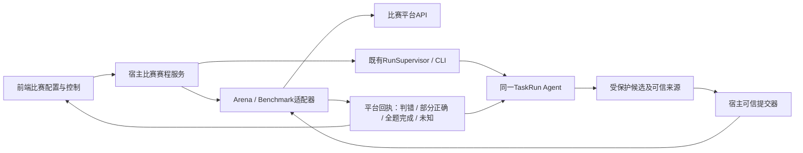

# C01 启动器与比赛平台连接计划

日期：2026-10-21。状态：C01-1 连接层已实现并通过本地受控验证；真实平台连接未验收，C01-2/3/4 尚未实施。全部本轮文档集中在Control，只有计划与验收两份；后续更新原文件，不为每个子步骤另建文档。

## 1. 用户已确认的规则

- 一个启动器，多份“比赛配置”，不是复制多个Agent版本。首批NSSCTF Agent Arena、Benchmark两种协议，前端显式选择和编辑非秘密配置。
- 自动串行答题，一次一道：Arena维护当前attempt并领取下一题；Benchmark按前端显示的队列顺序执行，不暗自改变顺序。
- 立即停止实际定义为暂停赛程与当前Agent，保留本题进展，之后继续原TaskRun。不得用取消/杀进程冒充暂停，不自动abandon或close未完成题。
- 本题完成后停止：当前题进入成功、平台失败或到期终态后，不再领取/启动下一题。请求可以撤销；与立即暂停分开。
- 一题一个TaskRun。多Flag题单个Flag正确只增加进度，平台确认整题完成才判TaskRun成功。
- 明确判错且题目仍有效：提交器保存平台结果并交回同一TaskRun，Agent继续；不让模型代替平台判定，不把网络/鉴权/协议错误当成Flag错误。
- 用户可显式延长尚未到期的单题与整体本地预算。单题受整体截止约束，二者均受平台有效期约束；平台文档没有延期接口，不宣称本地延时能延长平台。不能复活已终态TaskRun。
- 复用现有内外层LLM、Sandbox、MCP、Fact审核及独立最终验证；本轮不顺带实现GPT/Claude模型适配。
- 本轮仅实施C01-1连接层；Arena本地单题预算到期而平台题仍active时，后续赛程必须暂停等待用户处理，不自动abandon扣分。

## 2. 资料及当前可复用边界

资料：用户本轮附件《已粘贴的文本.txt》，包含两个接口示例。所有例子均视为接口说明，不把示例token/flag当作真实配置。参考布局项目：https://github.com/Small-tailqwq/dsh-deep-whale 。仅借鉴导航、工作区及配置面板组织，使用原创Qinyuan样式，不复制人物、美术或皮肤代码。已阅读README与公开客户端源码；远端预览图片未成功呈现，不声称已完成视觉验收。

当前代码核对：

- agent_adapters/workbench.py和frontend已有回环工作台、任务/模型配置、来源校验；复用同一HTTP服务和RunSupervisor，不再启动第二套任务执行器。
- agent_adapters/validation_check.py的configured_checker当前返回None，没有生产比赛校验器；公网请求到达工作台不等于比赛连接已完成。
- agent_core/answer_candidates.py的after_success依赖原HTTP/附件Execution；MCP专属证据曾明确跳过最终候选。若真实题目候选来自MCP，必须补匹配的可信来源协议，不能伪造HTTP Execution或直接从普通日志grep后提交。
- agent_core/controller.py中accepted反馈会直接映射ACHIEVED。多Flag的部分正确不能照搬该映射，也不能伪装成rejected/unknown。
- rejected反馈已有回到RUNNING与既有树继续的基础；可信反馈需绑定TaskRun、candidate_id、evidence_version、operation_id，不接受前端自报正确或错误。
- 现有cancel为终态取消/清理；TaskRun deadline有持久化校验。可恢复人工暂停与显式用户延时需新增受控命令，不能改UI字段或原地改control.sqlite。
- 前轮已实现真实新运行Docker引擎最多10秒就绪等待，在TaskRun开始计时前；本轮继续复用。

不改原Architecture.md/interface.md/protocol.md/restrict.md及两个SVG。新增控制命令与多Flag成功口径须先在本计划中明确，再实施最小可信端扩展，不能绕过原所有权、证据、授权或幂等边界。

## 3. 布局与前端交互

采用左导航＋顶部赛程控制＋中央题目/Agent进展＋右侧配置/状态的布局。左侧导航：比赛控制、任务与运行、模型角色。保留现有手动工作台入口。

```text
┌ 比赛配置：Arena / Benchmark ─ 连接状态 ─ 总剩余时间 ─ 整体延时 ┐
│ 开始/继续自动答题 │ 立即暂停 │ 本题结束后停止 │ 当前题延时       │
├ 左侧队列 ────────── 中央当前题与Agent ─────── 右侧详情 ────────┤
│ 当前题 / 待答      │ 题面、有效地址、附件      │ 平台连接/凭据状态 │
│ 已完成 / 失败      │ Turn/Intent、工具进展     │ 单题/整体截止     │
│ 平台题目标识      │ Flag候选与脱敏提交反馈    │ 0/3 Flag、错误次数 │
│ 调整未启动题顺序  │ 分类日志/未知待核验提示   │ 参数、配置来源    │
└─────────────────────────────────────────────────────────────┘
```

- 配置选择、测试连接、题目预览、平台操作和Agent执行状态分开展示；连接成功只证明认证读取成功。
- 明确显示“正在暂停，等待已准入调用结束/核验”与“已暂停”；不能在模型/工具仍执行时显示已安全停止。
- 输入平台地址、凭据（C01-1只保存在服务进程内存）、单题/整体预算、Benchmark队列、目标地址协议映射、结束后停止。运行中平台/认证/协议等改变只影响下次赛程；暂停/延时属于有审计的当前运行命令。
- 地址没有scheme时不得根据端口猜http/https/tcp。Arena匿名题目使用“本地显示名：Arena attempt #...”而不是虚构平台题目ID/名称/标签。非当前Agent支持的题型或缺失授权/协议时明确阻塞，不伪装成已运行。
- C01-1 profile仅保存普通配置，凭据按配置ID关联到服务进程内存，浏览器不保存token到localStorage；查询不回传密钥。平台认证不进入LLM Prompt或Sandbox环境。模型API和比赛API是两套独立配置。

## 4. 连接职责与数据流



前端不直接访问平台、不提交自己编造的verdict；比赛服务不生成Intent/Plan、不执行Agent工具、不审核Fact。平台token只由宿主适配器用于该配置的固定API操作；不得泄漏给目标站点。现有run_id/task_run_id作为关联主键，平台attempt_id或unique_code只承担题目归属；不再生成多套等价任务ID。

平台适配器只提供明确操作：测试/读取当前或列表、领取/准备题目、查询题目、提交受保护候选、核对既有提交、完成题目资源释放。协议路径与判定规则固定在适配器，前端编辑参数不等于开放任意脚本/SQL/响应判成功表达式。新比赛可复用同一协议配置；响应语义不同才增加小适配器，不分叉整套运行代码。

### Arena映射

| 操作 | 接口 | 用途与约束 |
|---|---|---|
| 测试连接/恢复当前 | GET /api/skill/agent/arena/current/ | attempt=null为连接成功但无题，不能自动领取 |
| 自动赛程领取 | POST /api/skill/agent/arena/next/ | reused=true绑定当前attempt，不新建重复本地TaskRun |
| 状态核验 | GET /api/skill/agent/arena/attempt/{attempt_id}/ | 有效期、题面、错次与平台终态 |
| 提交 | POST .../{attempt_id}/submit/ | 宿主注入Bearer，正文仅真实候选flag；平台correct及状态决定结果 |
| 放弃 | POST .../{attempt_id}/abandon/ | 有评分后果；不自动调用；本地超时而平台仍active时暂停等待用户处理 |

题目描述取problem.content；附件及container.url保持平台来源。剩余时限按取回时刻换算为平台截止，网络往返计入有效期；不能每次轮询都重置本地题目预算。

### Benchmark映射

| 操作 | 接口 | 用途与约束 |
|---|---|---|
| 连接/列表/核验 | GET /openapi/v1/challenges | 读取unique_code、进度、container_status和地址 |
| 准备题目 | POST /openapi/v1/challenges/start?unique_code=... | 启动平台靶场，与本地Docker就绪等待不是同一件事 |
| 提交 | POST /openapi/v1/challenges/submit | JSON unique_code+flag；BENCHMARK_TOKEN只由宿主注入 |
| 提示 | GET .../hint?unique_code=... | 会扣分；首版不自动调用 |
| 资源释放 | POST .../close?unique_code=... | 已完成题按平台规则关闭；暂停未完成题不关闭 |

串行虽低于平台最多3题并发上限，仍须识别已有实例与资源不足，不自行关闭不属于本赛程的题。VPN由用户提供；首版只显示连通/不可达，不自动修改系统VPN/路由。该示例未给出可查询的精确平台截止字段：须从官方任务元数据或前端显式平台截止配置获得，未获得时标为未知，不把本地预算称平台剩余时间。

## 5. 自动赛程与控制语义

赛程状态建议最小集合：idle、running、pausing、paused、stopping_after_current、finished、needs_attention；题目状态复用已有TaskRun及平台投影，不再复制一套执行状态机。

1. 开始：冻结比赛配置，验证连接/凭据与能力范围，读取平台已有状态，选择第一道；准备目标与授权，复用既有入口创建TaskRun。
2. 正在运行：只保持一个活动题目/TaskRun。监视受保护候选与平台回执；允许Agent自己的Intent回访和父轮回溯，赛程不代替其推理。
3. 立即暂停：先持久化人工暂停请求，阻止领取/启动/新模型/新工具/新提交；等待已准入操作留下已知结果，未知按原规则核验。保留TaskRun、树、Fact、证据与专属Sandbox。不能把SIGKILL/cancel或TaskRun终态当作暂停。
4. 继续：恢复同一TaskRun，先核验平台题目仍有效及未知操作，再解除人工暂停。不得重放已提交的工具/flag。
5. 本题结束后停止：不打断当前题；题目达到已确认终态后停止赛程，清除本次停止标记。不再next/start。暂停优先阻止新操作；用户可撤销该停止请求。
6. 题目完整完成：可信平台整体完成回执提交TaskRun成功，按平台规则释放本赛程题目资源；再选择下一题。部分正确不走本步骤。
7. 整体时间耗尽：不再领取/启动，停止当前新的调度，保留回执/进展并按既有deadline处理；等待/暂停期间实际时钟继续，不冻结平台或整体时限。
8. 本地单题超时而Arena仍active时，暂停赛程等待用户处理；不重复next，也不自动abandon扣分。

## 6. 单题与整体延时

原始请求与授权保留。增加明确的用户控制命令，绑定赛程/TaskRun、幂等operation_id、原有效截止、新有效截止和用户来源；通过Controller/存储校验追加审计，而不是界面直接覆盖字段。仅允许单调延长且原运行未到期/未终态，不能由LLM申请自增。

```text
当前题有效截止 = min(本地单题截止, 本地赛程整体截止, 已知平台题目截止, 已知平台任务截止)
```

UI同时显示各层截止及当前限制来源。延长整体不会自动增加当前题预算；延长单题受整体和平台限制，超过时明确提示，并允许用户另行延长整体。重复请求不重复加时；和deadline判定/提交并发时以可信事务内的当前状态和时钟裁决。没有平台延期接口就不能“修改平台截止”。Benchmark平台时限未知时必须明确说明，不编造可用时间。

## 7. Flag闭环与错误分类

使用同一提交operation_id关联候选、来源版本、题目与回执。真实flag只在受保护候选/提交边界读取，不在普通日志或前端进展批量明文展示，不把平台认证交给Agent。

| 平台结果 | 含义 | Agent/赛程行为 |
|---|---|---|
| 明确correct=false，题目仍有效 | 当前候选错误 | 保存脱敏理由/错次/进度，交回同一TaskRun继续；不重置树，不开重复TaskRun |
| correct=true，但correct_flag_count<total_flag_count | 部分正确 | 保存平台进度，不冒充Fact、未知或rejected；Agent继续找剩余flag |
| correct=true并明确solved/is_completed或已全量匹配 | 整题完成 | 可信整体完成判定后才能ACHIEVED |
| duplicate | 已提交过某个正确flag | 查询当前题目进度并核对绑定，不盲目算新正确，也不算错 |
| 鉴权/404 task_not_found | 配置/身份错误 | 暂停赛程提示配置，不能当候选错误回传继续撞平台 |
| 409 invalid_state | 可能任务结束、题已完成或实例已满 | 结合操作和权威状态查询分类，不能统一当超时/判错 |
| 422 | 请求契约错误 | 报提交参数/协议问题，不制造Flag错误结论 |
| 503/5xx/连接或读取中断 | 技术失败或提交结果未知 | 不当判错，不自动重放有副作用POST；可用只读查询核验，否则等待处置 |
| 错次耗尽/平台已结束/目标已失效 | 平台不能继续 | 收束当前题并展示限制，不能承诺Agent继续有效解题；按已确认赛程策略处理 |

一次提交前先持久化候选绑定/operation_id及开始记录，收到后保存脱敏平台回执再应用控制结果。崩溃后按原绑定恢复应用，不能再次POST来“恢复”。当前资料没有幂等key或逐提交查询接口，不能凭attempt solved/计数增加就断言某个未知候选正确；题目完成事实与具体未知候选的裁决分开。

现有accepted直接结束任务的契约须最小扩展为“候选判定”和“整题完成判定”分离；不修改旧回执意义，也不把部分正确写为unknown。正式Fact仍经外层审核和可信来源验证，平台得分事件不是自动verified Fact。

## 8. 分阶段执行与验收门

| 阶段 | 交付 | 必须证明 |
|---|---|---|
| C01-1 连接 | 两种小适配器、配置/凭据绑定、前端测试连接/列表预览 | 前端→宿主→平台只读链路；错误分类；凭据不泄漏；不用真实题目副作用验证 |
| C01-2 Agent桥接 | 题面/地址/附件/授权映射，可信提交与回执，MCP候选来源及多Flag整体判定 | 错flag继续同Run、部分正确不中止、全题完成才成功、未知不重发 |
| C01-3 自动控制 | 串行赛程、立即暂停/继续、题终态后停止、单题/整体显式延时 | 持久恢复、无新操作穿过暂停、deadline并发及单次延时幂等 |
| C01-4 界面装配 | 原创布局、可编辑比赛配置、队列/进度/分类日志与控制按钮 | 已装配能力可用，未实现按钮不伪装可用；移动/窄窗可读 |

先完成设计核对和C01-1，随后按确认范围实施核心桥接与赛程；不能只凭连接成功宣布自动比赛闭环完成。没有平台真实地址/非秘密配置/用户输入凭据时，只能做本地假服务验收；不索取聊天中的密钥，不登录或领取真实题目，不提交示例flag。

## 9. 待确认/待补资料

1. 真实验收前补Benchmark平台地址/平台总截止来源、Arena判错/错次耗尽的脱敏回执及状态枚举、附件取回和凭据保存偏好。只通过前端或受保护配置输入密钥。
2. 若新题型/目标协议不在当前Agent授权能力内，需逐项确认工具/网络接入，不通过伪造http地址绕过限制。

## 10. C01-1 实施记录

- 连接适配集中于 `agent_adapters/competition.py`；`workbench.py`仅装配服务、静态资源和固定管理路由。没有新增Agent调度器、TaskRun状态或内核契约版本。
- 配置保存在既有工作台数据库的 `competition_profiles` 表，仅含ID、名称、协议、根地址、读取超时；凭据只在进程内存，查询仅返回是否已配置。留空保存保留同平台同地址的凭据；改变协议/地址清除旧凭据；显式清除立即阻止后续认证读取。重启需重新输入。
- 管理路由：`GET/POST /api/competition/profiles`、`PUT /api/competition/profiles/{id}`、`DELETE .../{id}/credential`、`POST .../{id}/check`（空对象）。连接检查只向所选平台发固定GET，不跟随跳转，不下载附件，不启动Agent。
- 界面沿用现有导航、主题和同源请求，新增“比赛连接”；提供新建/切换/编辑、凭据清除、手动连接检查、匿名Arena当前题和Benchmark列表预览。题面按纯文本渲染，地址保留平台原值，不推测协议。自动赛程等能力仅说明后续接入，不展示伪可用按钮。
- 错误以 `competition_*` 分类：配置/凭据、认证、限流、平台状态/请求/资源、业务失败、格式/大小、跳转、超时/TLS/传输。日志复用 `sys`，事件为 `competition.connected` / `competition.connection_failed`，记录配置ID、协议、分类及错误码；成功记录耗时，不记录凭据、完整平台响应或题面。
- 本连接层显式限制：单次读取响应最多2 MiB（`MAX_RESPONSE_BYTES`）；配置超时默认10秒，可调1–60秒（HTTP连接/读取socket超时，并非整个Agent预算）；配置名称1–80字符、平台根地址最多2048字符、凭据最多8192个可打印非空白ASCII字符，Benchmark凭据须为UUID。位置为 `competition.py` 的 `_origin`、`_read`、`CompetitionConnections.save` 以及 `index.html` 同步输入约束。这些限制不改变模型输出或TaskRun时限。
- 使用方式：在本项目运行 `start-workbench.cmd` → “比赛连接” → 新建配置 → 选择协议、填写真实根地址及凭据 → 保存 → 测试连接。实际凭据由用户直接在本地界面输入，不发到聊天；平台模型配置与比赛认证各自独立。
- 本地验证及未覆盖边界见同目录验收文档。连接成功仅证明当次认证读取成功，不能据此声称领取、提交或整题闭环已可用。

## 11. C01-2 执行标准（用户确认，2026-10-21）

范围：单题导入并复用现有运行入口，MCP受保护候选，宿主提交与平台反馈。串行赛程、领取下一题、人工暂停与延时仍属C01-3。真实验收由用户进行，本轮只运行本地受控用例。

1. 平台题面、远端标识和明确HTTP(S)目标导入现有工作台题目；同一配置/远端题复用本地绑定，活动TaskRun不得重复创建。无协议IP:端口要求显式指定，其他协议/多目标缺失能力逐项确认。远端附件保留下载信息，使用原上传链，不自动下载或转发平台认证。
2. MCP候选复用现有保护存储及登记表。source_ref指向已知MCP操作结果，evidence_version绑定内容；Plan/Execution为空，不伪造对象。核验当前TaskRun/Turn/Intent、操作完成及证据完整性。候选仍在局部Intent成功后提出，不另增逐工具审核。
3. 新增partial反馈：候选正确但整题未完成，Controller恢复RUNNING；accepted仍表示整题成功，rejected表示明确判错，unknown表示结果待核验。平台进度经关联回执提供给后续模型输入，不自动创建Fact。
4. 平台配置在运行绑定时冻结，凭据仅宿主进程持有；平台提交由可信适配入口读取受保护候选。持久化提交开始→固定API调用→脱敏回执→Controller应用。开始后结果不明不得自动重发；已有回执只补应用。按题目及正文摘要阻止换候选ID重复自动提交。
5. 一次schema29→30迁移，复用现有候选/反馈表，允许MCP来源及partial；保留旧记录，原来源校验不放宽。提交记录复用文件证据及操作标识，不增加平行候选表。旧库只读不迁移，原真实现场不用于迁移测试。
6. 定向验收：导入绑定、有效/无效MCP来源、错flag继续同Run、partial不中止、整题才成功、提交各边界中断不重复POST、凭据/候选正文不进入普通返回或日志。文档仅更新本计划和同目录验收文件。
